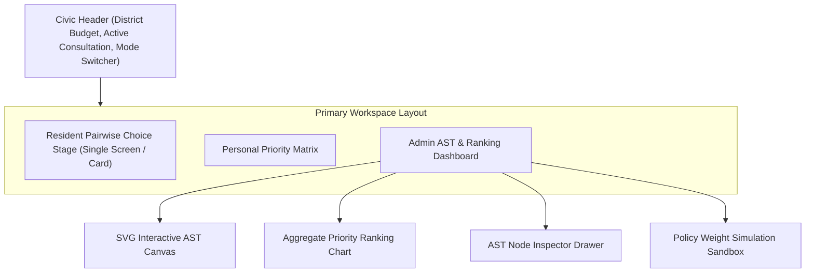

# The Barter Bridge — Design Specification & Research Notes

> **Version:** 2.0  
> **Status:** Research-Verified Design Specification  
> **Evaluation Date:** 2026-10-10  
> **Domain:** Civic Preference AST Engine & Trade-Off Simulator  

---

## 1. Original Concept & Non-Negotiable Product Intent
The Barter Bridge is a civic participation experience that helps residents express trade-offs when a municipality or district cannot fund every desirable infrastructure project. Rather than using vague star ratings or simple polls, it guides users through forced pairwise trade-off choices (e.g., *Stormwater Drainage* vs *Road Resurfacing*) and converts those inputs into an explainable Abstract Syntax Tree (AST) priority model.

**Non-Negotiable Intent:**
- Preserve the exact concept of a Civic Preference AST Engine.
- Make the decision rules transparent, inspectable, and editable via an AST node inspector.
- Distinguish baseline public preference rankings from policy simulation overrides.
- Ensure 100% offline deterministic execution without paid API keys.

---

## 2. Product Positioning & Intended Users
- **Primary Users:** District residents, municipal budgeting officers, civic researchers, and community council members.
- **Value Proposition:** Replaces black-box public surveys with an interactive AST rule canvas where every aggregated ranking can be traced back to explicit pairwise trade-off choices and rule weights.

---

## 3. Core User Journey
1. **District Briefing Landing:** Participant views district budget constraints ($5,000,000 Total Allocation) and 5 competing municipal projects.
2. **Guided Pairwise Trade-Off Flow:** Resident completes a 5-step forced-choice survey comparing two projects at a time (e.g., Option A: *River Basin Flood Barrier* [$2.1M] vs Option B: *Solar Power Microgrid* [$1.8M]).
3. **Personal Priority Summary:** Interface displays the participant's derived priority matrix and trade-off rationale.
4. **District Aggregate Ranking & AST Canvas:** User or admin views the district-wide aggregated ranking alongside an interactive AST decision tree canvas.
5. **Node Inspection:** Admin selects an AST node (e.g., `WEIGHTED_SUM(Safety: 0.45, Infrastructure: 0.35, Sustainability: 0.20)`). Side inspector reveals raw inputs, operation, and downstream ranking effects.
6. **Policy Sandbox Simulation:** Admin adjusts rule weights (e.g., increasing *Sustainability* weight from 0.20 to 0.50) and compares the simulated ranking against the baseline public preference.

---

## 4. Information Architecture

---

## 5. Screen Inventory
1. **Resident Consultation Flow (`/resident`):** Step-by-step pairwise forced-choice survey with progress bar and balanced project cards.
2. **Personal Priority Summary (`/resident/summary`):** Individual participant result card with exportable summary.
3. **Admin AST Workspace (`/admin`):** 3-zone workspace containing District Ranking Chart (Left), Interactive AST Canvas (Center), and Selected Node Inspector (Right).
4. **Accessible ARIA Tree View (`/accessible`):** Linear HTML tree structure (`role="tree"`) for keyboard and screen reader accessibility.

---

## 6. Low-Fidelity Wireframe Descriptions
- **Resident Choice View:** Top progress bar (`Step 3 of 5`). Two large side-by-side cards (`Option A` vs `Option B`). Each card has project title, category tag, cost badge, impact summary, and prominent `SELECT THIS OPTION` button (`2px solid #000`, background `#B2FF05` on hover/focus).
- **Admin AST Dashboard:**
  - *Left Column (30% width):* Ranked Project List with percentage support bars and baseline vs simulation diff badges.
  - *Center Column (45% width):* Dark charcoal AST canvas background (`#18181B`) rendering interactive SVG tree nodes (`Root`, `Weighted Sum`, `Category Filters`, `Project Leaf Nodes`).
  - *Right Column (25% width):* Selected AST Node Inspector showing Node ID, Mathematical Operator, Weight Slider, and Derived Ranking Impact.

---

## 7. Visual Identity & Art Direction
- **Style:** Editorial Neo-Brutalist Civic Design.
- **Atmosphere:** Clean, high-contrast, trustworthy, public-facing editorial aesthetic.
- **Rules:** Bold typography, crisp 2px solid black borders (`#000000`), warm off-white surfaces, vibrant lime signal accent (`#B2FF05`), zero decorative fluff or crypto gradients.

---

## 8. Typography System
- **Display Headlines:** Space Grotesk / Inter (`700` weight, all-caps accents).
- **UI Body & Labels:** Inter (`400`/`500` weight).
- **Technical Telemetry & AST Formulas:** JetBrains Mono (`400`/`600` weight, `tabular-nums`).

---

## 9. Color Tokens & Semantic Roles
- `bg-surface-root`: `#F9F8F6` (Warm Off-White)
- `bg-surface-card`: `#FFFFFF` (Pure White Card)
- `bg-surface-dark`: `#18181B` (Deep Charcoal for AST Canvas)
- `border-bold`: `#000000` (2px Solid Black Border)
- `text-primary`: `#18181B` (Deep Charcoal Text)
- `text-muted`: `#71717A` (Muted Secondary Text)
- `accent-signal`: `#B2FF05` (Vibrant Lime Accent)
- `status-baseline`: `#3B82F6` (Blue for Public Baseline)
- `status-simulation`: `#F59E0B` (Amber for Policy Simulation)

---

## 10. Spacing, Sizing & Surface Rules
- **Base Grid Unit:** 8px (Scale: 8, 16, 24, 32, 48, 64px).
- **Border Radius:** Sharp neo-brutalist radii (`2px` on cards, `0px` on heavy borders).
- **Borders:** `2px solid #000000` on all interactive cards and buttons.

---

## 11. Component Inventory
- `PairwiseChoiceCard`: Two-option forced-choice card component.
- `ASTCanvasSVG`: Interactive SVG graph rendering AST decision nodes and connecting edges.
- `ASTNodeInspector`: Side drawer for inspecting and modifying rule node parameters.
- `RankingChart`: Bar chart comparing public baseline vs policy simulation rankings.
- `PolicySandbox`: Weight adjustment sliders for real-time scenario simulation.
- `ARIATreeFallback`: HTML treeview structure (`role="tree"`) for screen readers.

---

## 12. Interaction Specifications
- **Choice Click / Key:** Selecting Option A or B advances survey step, records choice in state, and recalculates personal priority matrix.
- **AST Node Click:** Clicking any node on the SVG canvas highlights its path to the root and populates the Node Inspector.
- **Weight Slider Drag:** Adjusting a category weight slider immediately recalculates the simulated ranking and displays a diff indicator.

---

## 13. Motion & Transition Rules
- **Choice Transition:** Horizontal slide (`200ms ease-in-out`) between survey steps.
- **AST Node Selection:** Node outline stroke width expands from `2px` to `4px` with a brief lime glow (`#B2FF05`).
- **Reduced Motion:** If `prefers-reduced-motion: reduce` is active, step transitions are instant (`0ms`).

---

## 14. Data Visualization Mathematics
1. **Pairwise Borda / Bradley-Terry Scoring:**
   $$\text{Score}(P_i) = \frac{\sum_{j \neq i} w_{ij} \cdot \mathbb{I}(P_i \succ P_j)}{\text{Total Comparisons}(P_i)}$$
2. **AST Weighted Evaluation Formula:**
   $$\text{FinalScore}(P_i) = \sum_{c \in Categories} W_c \cdot \text{Score}_{raw}(P_i, c)$$
3. **Ranking Shift Diff:**
   $$\Delta \text{Rank}(P_i) = \text{Rank}_{sim}(P_i) - \text{Rank}_{base}(P_i)$$

---

## 15. Responsive Layout Behavior
- **Desktop ($\ge 1024\text{px}$):** 3-column admin dashboard (30% ranking, 45% AST canvas, 25% inspector).
- **Tablet ($768\text{px} - 1023\text{px}$):** 2-column layout; AST canvas full width top, inspector and ranking stacked below.
- **Mobile ($< 768\text{px}$):** Resident flow stacks single-column with large 48px tap targets. Admin view displays collapsible tabs for Ranking, Canvas, and Inspector.

---

## 16. Keyboard Navigation & Accessibility Requirements
- Full keyboard support for choices (`KeyA`/`KeyB` or `ArrowLeft`/`ArrowRight`).
- AST Tree navigation via `ArrowUp`/`ArrowDown`/`Enter` in ARIA Tree view.
- Contrast ratio $\ge 7:1$ (Black text on Off-White background).
- Focus ring: `3px solid #B2FF05` with `2px` black offset.

---

## 17. Loading, Empty, Error & Offline States
- **Loading:** Neo-brutalist skeleton loader with text: `EVALUATING AST DECISION TREE...`.
- **Offline Banner:** `[OFFLINE MODE — 100% DETERMINISTIC LOCAL MOCK DATASET]`.
- **Error:** Actionable card with `RESET SIMULATION` button.

---

## 18. Deterministic Demo-Data Specification
- **District Projects (5 total):**
  1. *River Basin Flood Barrier* ($2.1M, Category: Safety)
  2. *Solar Power Microgrid* ($1.8M, Category: Sustainability)
  3. *Main Street Road Resurfacing* ($1.2M, Category: Infrastructure)
  4. *Community Health Center Clinic* ($1.5M, Category: Health)
  5. *Public Library Tech Hub* ($0.8M, Category: Education)
- **Seeded Public Responses:** 250 deterministic participant choice records.

---

## 19. Performance Considerations
- Custom SVG graph layout without heavy external D3 bundle.
- State recalculations performed in-memory in under 5ms.

---

## 20. Research & Source Citations
- **W3C ARIA Treeview Pattern:** [w3.org/WAI/ARIA/apg/patterns/treeview](https://www.w3.org/WAI/ARIA/apg/patterns/treeview/) (Checked: 2026-10-10)
- **Stanford Participatory Budgeting Methodology:** [participatorybudgeting.stanford.edu](https://participatorybudgeting.stanford.edu/) (Checked: 2026-10-10)

---

## 21. Proposed Implementation Architecture
- **Framework:** React 19 + TypeScript + Vite (`barter-bridge/`).
- **Rendering:** Custom SVG AST canvas component + HTML choice cards.
- **State Management:** React `useReducer` for survey state, AST node tree, and policy simulation weights.

---

## 22. Acceptance Criteria
- [x] Resident pairwise forced-choice survey guides user through 5 project trade-offs.
- [x] Individual priority summary displays personal ranking derived from choices.
- [x] Interactive SVG AST canvas renders rule nodes and permits node inspection.
- [x] Node inspector displays node operation, inputs, outputs, and downstream effect.
- [x] Policy simulation sandbox allows weight adjustments and displays baseline vs simulation diffs.
- [x] ARIA Treeview fallback (`/accessible`) provides full keyboard/screen-reader compliance.

---

## 23. Outstanding Questions & Unverified Assumptions
- `UNVERIFIED — LLM Natural Language Rationale Summarization:` Optional LLM clustering of free-text trade-off rationale is marked `UNVERIFIED` optional feature; deterministic rule engine acts as primary implementation.
