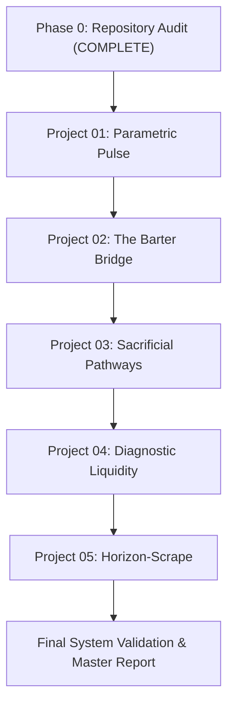

# Master Implementation Plan — Edge Systems Collection

## Executive Summary
This document provides the roadmap for executing the research, design, architecture, build, and validation loop for five creative engineering prototypes in `edgeProjDsgn`.

---

## Project Execution Sequence

---

## Detailed Project Roadmap

### Project 01 — Parametric Pulse (Smart-Contract Cyclone Liquidity)
- **Concept:** Climate risk interface for storm trajectory, trigger inspection, exposure calculation, and parametric liquidity payout demo.
- **Signature Interaction:** Interactive coastal storm visualization with timeline scrubber, forecast checkpoint inspector, exposure calculator, and auditable payout rule engine.
- **Architecture & Technical Stack (Phase 2 Verified):**
  - **Framework & Bundler:** React 19 + TypeScript (`vite`, `@vitejs/plugin-react`). Self-contained build in `parametric-pulse/`.
  - **Rendering Layer:** HTML5 Canvas 2D storm trajectory scene (`StormCanvas2D`) + SVG interactive asset overlays (`SpatialAssetMarker`).
  - **State Management:** Custom React reducer (`useReducer`) managing scrubber position, active scenario, asset selection, and payout state machine (`IDLE` -> `EVALUATING` -> `TRIGGERED` -> `LIQUIDITY_LOCKED` -> `PAYOUT_DISPATCHED` -> `CONFIRMED`).
  - **Data Boundaries & Contracts:** Seeded TypeScript data modules (`src/types/index.ts`, `src/data/demoScenarios.ts`) providing 100% deterministic local data for Category 2 (Non-Qualifying) and Category 4 (Qualifying Landfall) scenarios.
  - **Run & Validation Commands:**
    - Dev server: `npm run dev` (Port 3000)
    - Production build: `npm run build`
    - Typecheck: `npm run lint` (`tsc --noEmit`)
- **Phase 3 Build Stage Roadmap:**
  - Stage A: Interaction Spec & State Model Schema Definition.
  - Stage B: Canvas 2D Signature Prototype (Storm track, spline interpolation, scrubber).
  - Stage C: Deterministic Data Engine (Category 2 vs Category 4 scenarios).
  - Stage D: Complete System States (Loading, Offline Banner, Error, Mobile Stack, ARIA Table Fallback).
  - Stage E: Design Polish & Cybernetic Visual System.
  - Stage F: Build Validation, Type Checks, & Integration Sanity.
  - Stage G: Final README Update, Demo Script, & Verified Commit.

### Project 02 — The Barter Bridge (Civic Preference AST Engine)
- **Concept:** Civic participation decision simulator transforming public trade-offs into an explainable AST and priority ranking.
- **Signature Interaction:** Guided trade-off choice flow linked to an explorable decision tree and rule evaluation engine.

### Project 03 — Sacrificial Pathways (Topographic Flood Routing)
- **Concept:** Geospatial exploration prototype comparing hypothetical floodwater routes across urban basin terrain.
- **Signature Interaction:** Interactive terrain canvas with route comparison, flow rate simulation, and consequence analysis.

### Project 04 — Diagnostic Liquidity (Algorithmic Crop Subsidy)
- **Concept:** Mobile-first crop-damage intake and explainable triage workflow.
- **Signature Interaction:** Image intake preview, visual lesion annotation, confidence score card, and support/insurance case state machine.

### Project 05 — Horizon-Scrape (Ambient Optical Smog Canvas)
- **Concept:** Crowdsourced environmental observation experience using horizon photos and visual haze filters.
- **Signature Interaction:** Dual image comparison stage (original vs processed visual proxy) connected to a time-filtered map and historical observations.

---

## Quality & Validation Gates
Each project must pass all applicable validation gates (A through G) before moving to the next project.
