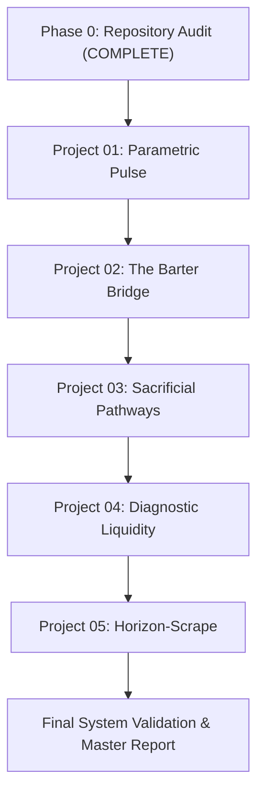

# Master Implementation Plan — Edge Systems Collection

## Executive Summary
This document provides the roadmap for executing the research, design, architecture, build, and validation loop for five creative engineering prototypes in `edgeProjDsgn`.

---

## Project Execution Sequence

---

## Detailed Project Roadmap

### Project 01 — Parametric Pulse (Smart-Contract Cyclone Liquidity)
- **Concept:** Climate risk interface for storm trajectory, trigger inspection, exposure calculation, and parametric liquidity payout demo.
- **Signature Interaction:** Interactive coastal storm visualization with timeline scrubber, forecast checkpoint inspector, exposure calculator, and auditable payout rule engine.
- **Architecture & Technical Stack (Phase 2 Verified):**
  - **Framework & Bundler:** React 19 + TypeScript (`vite`, `@vitejs/plugin-react`). Self-contained build in `parametric-pulse/`.
  - **Rendering Layer:** HTML5 Canvas 2D storm trajectory scene (`StormCanvas2D`) + SVG interactive asset overlays (`SpatialAssetMarker`).
  - **State Management:** Custom React reducer (`useReducer`) managing scrubber position, active scenario, asset selection, and payout state machine (`IDLE` -> `EVALUATING` -> `TRIGGERED` -> `LIQUIDITY_LOCKED` -> `PAYOUT_DISPATCHED` -> `CONFIRMED`).
  - **Data Boundaries & Contracts:** Seeded TypeScript data modules (`src/types/index.ts`, `src/data/demoScenarios.ts`) providing 100% deterministic local data for Category 2 (Non-Qualifying) and Category 4 (Qualifying Landfall) scenarios.
  - **Run & Validation Commands:**
    - Dev server: `npm run dev` (Port 3000)
    - Production build: `npm run build`
    - Typecheck: `npm run lint` (`tsc --noEmit`)
- **Phase 3 Build Stage Roadmap:**
  - Stage A: Interaction Spec & State Model Schema Definition `[COMPLETED]`. Defined `ScrubberState`, `AssetExposureState`, `TriggerEvaluationState`, `PayoutLifecycleState`, and `AppState` in `src/types/stateModel.ts`. Implemented `appReducer.ts` with pure transitions (`SET_CHECKPOINT_HOUR`, `SELECT_SCENARIO`, `SELECT_ASSET`, `TOGGLE_PLAYBACK`, `EVALUATE_TRIGGER`, `ADVANCE_PAYOUT_STEP`, `RESET_STATE`) and `calculateDistanceKm` Haversine formula utility.
  - Stage B: Canvas 2D Signature Prototype (Storm track, spline interpolation, scrubber).
  - Stage C: Deterministic Data Engine (Category 2 vs Category 4 scenarios).
  - Stage D: Complete System States (Loading, Offline Banner, Error, Mobile Stack, ARIA Table Fallback).
  - Stage E: Design Polish & Cybernetic Visual System.
  - Stage F: Build Validation, Type Checks, & Integration Sanity.
  - Stage G: Final README Update, Demo Script, & Verified Commit.

### Project 02 — The Barter Bridge (Civic Preference AST Engine)
- **Concept:** Civic participation decision simulator transforming public trade-offs into an explainable AST and priority ranking.
- **Signature Interaction:** Guided trade-off choice flow linked to an explorable decision tree and rule evaluation engine.
- **Architecture & Technical Stack (Phase 2 Verified):**
  - **Framework & Bundler:** React 19 + TypeScript (`vite`, `@vitejs/plugin-react`). Self-contained build in `barter-bridge/`.
  - **Rendering Layer:** Custom SVG interactive AST canvas (`ASTCanvasSVG`) + Neo-Brutalist HTML choice cards (`PairwiseChoiceCard`).
  - **State Management:** Custom React reducer (`useReducer`) managing survey step index, user choice map, selected AST node ID, category weight sliders, and Borda/Bradley-Terry ranking calculations.
  - **Data Boundaries & Contracts:** Seeded TypeScript data modules (`src/types/index.ts`, `src/types/stateModel.ts`, `src/data/demoDistrictData.ts`) providing 100% deterministic local data for 5 municipal projects, 12 AST nodes, and 250 seeded public response records.
  - **Run & Validation Commands:**
    - Dev server: `npm run dev` (Port 3001)
    - Production build: `npm run build`
    - Typecheck: `npm run lint` (`tsc --noEmit`)
- **Phase 3 Build Stage Roadmap:**
  - Stage A: Interaction Spec & State Model Schema Definition.
  - Stage B: SVG AST Canvas & Forced Choice Cards Signature Prototype.
  - Stage C: Deterministic Data Engine (5 municipal projects, 12 AST decision nodes, 250 seeded responses).
  - Stage D: Complete System States (Resident Survey, Personal Summary, Admin AST Workspace, ARIA Tree View).
  - Stage E: Design Polish & Neo-Brutalist Visual System (`#F9F8F6`, `#18181B`, `#B2FF05`).
  - Stage F: Unit Tests & Build Validation (`src/utils/astEvaluator.test.ts`).
  - Stage G: Final README Update, Demo Script, & Verified Commit.

### Project 03 — Sacrificial Pathways (Topographic Flood Routing)
- **Concept:** Geospatial exploration prototype comparing hypothetical floodwater routes across urban basin terrain.
- **Signature Interaction:** Interactive topographic elevation terrain canvas with route selection, hydraulic discharge control, sacrificial gate diversion toggle, and sectoral consequence inspector.
- **Architecture & Technical Stack (Phase 2 Verified):**
  - **Framework & Bundler:** React 19 + TypeScript (`vite`, `@vitejs/plugin-react`). Self-contained build in `sacrificial-pathways/`.
  - **Rendering Layer:** HTML5 Canvas 2D Topographic Elevation Surface (`TerrainCanvas2D`) with 2.5D contour lines, hydraulic flow velocity vectors, sector boundary overlays, and electric orange sacrificial bypass gate path (`#FF3D00`).
  - **State Management:** Custom React reducer (`useReducer`) managing discharge rate $Q$, water level offset $h$, active scenario (`Scenario A: Natural Channel Overflow` vs `Scenario B: Sacrificial Bypass Gate Open`), sacrificial gate position ($OPEN / CLOSED$), selected sector inspector, and accessibility view mode.
  - **Data Boundaries & Contracts:** Seeded TypeScript data modules (`src/types/index.ts`, `src/types/stateModel.ts`, `src/data/demoTerrainScenarios.ts`) providing 100% deterministic local terrain elevation grid ($20 \times 20$ heightmap matrix), 4 municipal sectors, hydraulic parameters, and risk scoring models.
  - **Run & Validation Commands:**
    - Dev server: `npm run dev` (Port 3002)
    - Production build: `npm run build`
    - Typecheck: `npm run lint` (`tsc --noEmit`)
- **Phase 3 Build Stage Roadmap:**
  - Stage A: Interaction Spec & State Model Schema Definition (`src/types/stateModel.ts`, `src/state/appReducer.ts`).
  - Stage B: Topographic Canvas 2D Terrain Surface Signature Prototype (`TerrainCanvas2D.tsx`, `RouteSelector.tsx`).
  - Stage C: Deterministic Hydraulic Data Engine (`demoTerrainScenarios.ts`, `FlowTelemetryCard.tsx`, `ConsequenceAnalyzer.tsx`).
  - Stage D: Complete System States (Loading, Offline Banner, Error Banner, Mobile Stacked Layout, `AccessibleElevationTable.tsx`).
  - Stage E: Design Polish & Cinematic Terrain Aesthetic (`#0D1117`, `#FF3D00`, `#00A3FF`).
  - Stage F: Hydraulic Flow Unit Testing & Build Validation (`src/utils/flowCalculator.test.ts`).
  - Stage G: Final README Update, 2-Minute Demo Script, & Release Commit.

### Project 04 — Diagnostic Liquidity (Algorithmic Crop Subsidy)
- **Concept:** Mobile-first crop-damage intake and explainable triage workflow.
- **Signature Interaction:** Mobile-first crop image intake preview, interactive HTML5 Canvas 2D lesion annotation inspector (`#FF00FF`), explainable diagnostic confidence card, and parametric subsidy claim settlement state machine.
- **Architecture & Technical Stack (Phase 2 Verified):**
  - **Framework & Bundler:** React 19 + TypeScript (`vite`, `@vitejs/plugin-react`). Self-contained build in `diagnostic-liquidity/`.
  - **Rendering Layer:** HTML5 Canvas 2D Crop Image Inspector (`LesionInspectorCanvas`) with interactive lesion bounding box overlays (`#FF00FF`), severity heatmap highlights, and zoom magnifier lens.
  - **State Management:** Custom React reducer (`useReducer`) managing active crop photo ID, confidence threshold filter, bounding box toggle, selected lesion inspector, claim settlement lifecycle state (`DRAFT` -> `INTAKE_SUBMITTED` -> `DIAGNOSTIC_EVALUATED` -> `ADJUDICATION_PENDING` -> `SUBSIDY_DISPATCHED` -> `SETTLED`), and view mode toggles.
  - **Data Boundaries & Contracts:** Seeded TypeScript data modules (`src/types/index.ts`, `src/types/stateModel.ts`, `src/data/demoCropData.ts`) providing 100% deterministic local data for 3 crop diseases (Maize Northern Leaf Blight, Wheat Stem Rust, Soy Healthy Control), 12 lesion bounding boxes, symptom match checklists, and parametric subsidy rate formulas ($850/hectare).
  - **Run & Validation Commands:**
    - Dev server: `npm run dev` (Port 3003)
    - Production build: `npm run build`
    - Typecheck: `npm run lint` (`tsc --noEmit`)
- **Phase 3 Build Stage Roadmap:**
  - Stage A: Interaction Spec & State Model Schema Definition (`src/types/stateModel.ts`, `src/state/appReducer.ts`).
  - Stage B: Canvas 2D Lesion Inspector Signature Prototype (`LesionInspectorCanvas.tsx`, `CropPhotoSelector.tsx`).
  - Stage C: Deterministic Data Engine & Formula Cards (`demoCropData.ts`, `DiagnosticConfidenceCard.tsx`, `ClaimSettlementCard.tsx`).
  - Stage D: Complete System States (Loading, Offline Banner, Error Banner, Mobile Layout, `AccessibleCropCaseReport.tsx`).
  - Stage E: Design Polish & Botanical Field Aesthetic (`#0F1410`, `#00E676`, `#FFAB00`, `#FF00FF`).
  - Stage F: Crop Damage & Subsidy Unit Testing (`src/utils/diagnosticEvaluator.test.ts`).
  - Stage G: Final README Update, 2-Minute Demo Script, & Release Commit.

### Project 05 — Horizon-Scrape (Ambient Optical Smog Canvas)
- **Concept:** Crowdsourced environmental observation experience using horizon photos and visual haze filters.
- **Signature Interaction:** Dual image comparison stage (original vs processed visual proxy) connected to a time-filtered map and historical observations.

---

## Quality & Validation Gates
Each project must pass all applicable validation gates (A through G) before moving to the next project.
