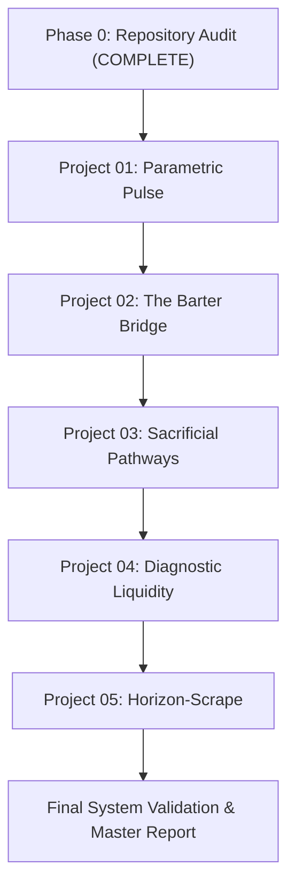

# Master Implementation Plan — Edge Systems Collection

## Executive Summary
This document provides the roadmap for executing the research, design, architecture, build, and validation loop for five creative engineering prototypes in `edgeProjDsgn`.

---

## Project Execution Sequence

---

## Detailed Project Roadmap

### Project 01 — Parametric Pulse (Smart-Contract Cyclone Liquidity)
- **Concept:** Climate risk interface for storm trajectory, trigger inspection, exposure calculation, and parametric liquidity payout demo.
- **Signature Interaction:** Interactive coastal storm visualization with timeline scrubber, forecast checkpoint inspector, exposure calculator, and auditable payout rule engine.
- **Stages:**
  - Phase 1: Research & Rewrite `DESIGN_NOTES.md`
  - Phase 2: Architecture & Setup `IMPLEMENTATION_PLAN.md`
  - Phase 3: Stage A (Interaction Spec) -> Stage B (Signature Prototype) -> Stage C (Deterministic Demo Data) -> Stage D (Complete States) -> Stage E (Design Polish) -> Stage F (Integration & Tests) -> Stage G (Release & README Update).

### Project 02 — The Barter Bridge (Civic Preference AST Engine)
- **Concept:** Civic participation decision simulator transforming public trade-offs into an explainable AST and priority ranking.
- **Signature Interaction:** Guided trade-off choice flow linked to an explorable decision tree and rule evaluation engine.

### Project 03 — Sacrificial Pathways (Topographic Flood Routing)
- **Concept:** Geospatial exploration prototype comparing hypothetical floodwater routes across urban basin terrain.
- **Signature Interaction:** Interactive terrain canvas with route comparison, flow rate simulation, and consequence analysis.

### Project 04 — Diagnostic Liquidity (Algorithmic Crop Subsidy)
- **Concept:** Mobile-first crop-damage intake and explainable triage workflow.
- **Signature Interaction:** Image intake preview, visual lesion annotation, confidence score card, and support/insurance case state machine.

### Project 05 — Horizon-Scrape (Ambient Optical Smog Canvas)
- **Concept:** Crowdsourced environmental observation experience using horizon photos and visual haze filters.
- **Signature Interaction:** Dual image comparison stage (original vs processed visual proxy) connected to a time-filtered map and historical observations.

---

## Quality & Validation Gates
Each project must pass all applicable validation gates (A through G) before moving to the next project.
