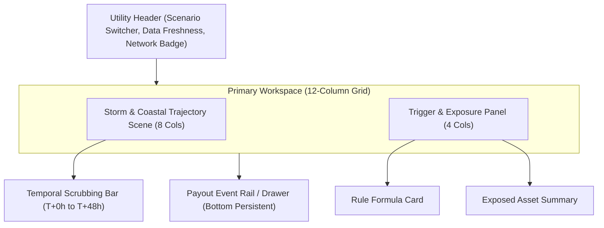

# Parametric Pulse — Design Specification & Research Notes

> **Version:** 2.0  
> **Status:** Research-Verified Design Specification  
> **Evaluation Date:** 2026-10-10  
> **Domain:** Smart-Contract Cyclone Liquidity & Climate Risk Visualization  

---

## 1. Original Concept & Non-Negotiable Product Intent
Parametric Pulse is a climate-risk operational workspace for visualizing a tropical cyclone's projected trajectory, translating verified environmental measurements into transparent parametric trigger conditions, and demonstrating how a qualifying extreme weather event automatically initiates a parametric liquidity payout.

**Non-Negotiable Intent:**
- Preserve the exact concept of smart-contract cyclone liquidity.
- Make the relationship between storm trajectory, exposed coastal assets, trigger rules, and payout states visually explicit.
- Ensure 100% offline deterministic execution with zero dependency on paid API services.

---

## 2. Product Positioning & Intended Users
- **Primary Users:** Municipal emergency response directors, climate risk analysts, parametric insurance pool managers, and technical hackathon judges.
- **Value Proposition:** Replaces opaque insurance spreadsheets with an auditable, real-time spatial telemetry workspace where storm track scrubbers directly update policy evaluation engines.

---

## 3. Core User Journey
1. **Situation Room Landing (T+0):** High-contrast dark navy ops room. Large central storm scene displays active cyclone track, landfall radius, and exposed coastal infrastructure.
2. **Trajectory Scrubbing & Checkpoint Inspection:** User scrubs temporal slider (T+0h to T+48h). Storm marker advances, updating real-time wind speed, pressure, and distance telemetry.
3. **Asset & Risk Exposure Inspection:** User selects a coastal asset (e.g., *Port Aurora Harbor Authority*). Spatial highlighting illuminates the hazard zone and loads policy parameters.
4. **Trigger Rule Evaluation:** Trigger Inspector renders the rule in plain language and structured logic:
   $$\text{Trigger} = \mathbb{I}\left(V_{max} \ge 130\text{ kts} \land \text{Distance} \le 45\text{ km}\right)$$
5. **Scenario Simulation (Qualifying vs Non-Qualifying):** User toggles demo scenarios. Scenario A (Category 2) fails trigger; Scenario B (Category 4 Landfall) satisfies trigger condition.
6. **Auditable Payout Execution:** Payout rail animates state machine progression:
   `IDLE` $\rightarrow$ `EVALUATING` $\rightarrow$ `TRIGGERED` $\rightarrow$ `LIQUIDITY_LOCKED` $\rightarrow$ `PAYOUT_DISPATCHED` $\rightarrow$ `CONFIRMED`.

---

## 4. Information Architecture

---

## 5. Screen Inventory
1. **Operations Dashboard (`/`):** Primary 12-column workspace containing storm scene, temporal scrubber, telemetry panel, and payout rail.
2. **Trigger Inspector Modal / Drawer:** Detailed mathematical breakdown of parametric rule conditions, historical comparison, and oracle verification trail.
3. **Asset Exposure Matrix:** Table view of all registered municipal assets, insured coverage amounts, and hazard radiuses.
4. **Accessible Tabular Fallback (`/accessible`):** High-contrast screen-reader optimized table layout replacing WebGL/Canvas canvas with ARIA-conforming telemetry.

---

## 6. Low-Fidelity Wireframe Descriptions
- **Top Bar (Height 56px):** Left logo + title; center scenario pill (`[DEMO: Category 4 Landfall]`); right data status badge (`[STATION DATA: VERIFIED | 100% SEEDED]`).
- **Main Canvas Stage (Left 65% width):** Dark navy background (`#0B0F19`) overlaid with subtle radar grid lines (`#1E293B`). Central coastal landmass outlined in `#334155`. Dynamic cyan storm track line (`#00E5FF`) with selectable forecast nodes.
- **Right Telemetry Panel (Right 35% width):** Stacked cards with fine borders (`1px solid #1E293B`).
  - *Top Card:* Current Checkpoint Telemetry (Wind speed gauge, Barometric pressure, Distance to Landfall).
  - *Middle Card:* Trigger Rule Evaluator with live status pill (`[SATISFIED]`).
  - *Bottom Card:* Parametric Liquidity Pool state ($2,500,000 USDC available).
- **Bottom Scrubber (Height 64px):** Full-width slider with tick marks every 6 hours, play/pause simulation controls, and step buttons.

---

## 7. Visual Identity & Art Direction
- **Style:** Scientific Operations Room / Meteorological Cybernetics.
- **Atmosphere:** Deep space navy, sharp fine-line framing, telemetry typography, high-visibility cyan signal accents.
- **Rules:** Zero decorative fluff. Every pixel, line weight, and color shift corresponds to actual storm state or trigger metrics.

---

## 8. Typography System
- **Display Headlines:** Inter / Space Grotesk (`700` weight, `1.2` line height).
- **UI Body & Labels:** Inter (`400`/`500` weight, `1.5` line height).
- **Telemetry & Monospace Values:** JetBrains Mono / Fira Code (`400`/`600` weight, tabular numbers `font-variant-numeric: tabular-nums`).

---

## 9. Color Tokens & Semantic Roles
- `bg-surface-root`: `#06080F` (Dark Space Navy background)
- `bg-surface-card`: `#0B0F19` (Elevated card background)
- `border-subtle`: `#1E293B` (Fine line framing)
- `text-primary`: `#F8FAFC` (High contrast text)
- `text-muted`: `#94A3B8` (Secondary telemetry text)
- `accent-signal`: `#00E5FF` (Cyan focus, active track, selected checkpoint)
- `status-success`: `#10B981` (Rule satisfied, payout confirmed)
- `status-warning`: `#F59E0B` (Approaching threshold)
- `status-error`: `#EF4444` (Breach / system failure)

---

## 10. Spacing, Sizing & Surface Rules
- **Base Grid Unit:** 4px (Spacing scale: 4, 8, 12, 16, 24, 32, 48, 64px).
- **Border Radius:** Sharp technical radii (`4px` on cards, `9999px` on status pills).
- **Elevation:** Flat borders (`1px solid #1E293B`) with optional subtle cyan glow (`0 0 12px rgba(0,229,255,0.15)`) for active trigger states.

---

## 11. Component Inventory
- `StormCanvas2D`: HTML5 Canvas rendering radar sweep, pressure rings, and track vector.
- `SpatialAssetMarker`: SVG overlay representing coastal infrastructure.
- `TimeScrubber`: Accessible interactive range slider for forecast scrubbing.
- `TriggerRuleCard`: Live rule evaluation widget displaying mathematical inequalities.
- `PayoutStateMachine`: Step-by-step event progression timeline.
- `ScenarioSwitcher`: Dropdown / pill bar to select seeded cyclone trajectories.
- `AccessibleTableFallback`: Tabular data view for screen readers and low-spec hardware.

---

## 12. Interaction Specifications
- **Scrubber Drag/Key:** Updating slider value recalculates track position, computes distance to selected asset, and evaluates trigger formula instantly.
- **Node Click:** Clicking any forecast node on the canvas snaps scrubber to that checkpoint timestamp.
- **Scenario Toggle:** Instant state transition resetting telemetry, recalculating rule compliance, and triggering state machine animation.

---

## 13. Motion & Transition Rules
- **Track Scrubbing:** Linear interpolation (`150ms ease-out`) for storm marker position.
- **State Machine Steps:** Staggered sequence (`300ms` per step) when payout sequence is triggered.
- **Reduced Motion:** If `prefers-reduced-motion: reduce` is detected, disable canvas radar rotation and set all state transitions to instant (`0ms`).

---

## 14. Data Visualization Mathematics
1. **Spline Interpolation:**
   $$\vec{P}(t) = (1-u)^2 \vec{P}_i + 2(1-u)u \vec{C}_i + u^2 \vec{P}_{i+1}, \quad u = \frac{t - t_i}{t_{i+1} - t_i}$$
2. **Haversine Distance to Asset:**
   $$d = 2R \arcsin\left(\sqrt{\sin^2\left(\frac{\Delta \phi}{2}\right) + \cos(\phi_1)\cos(\phi_2)\sin^2\left(\frac{\Delta \lambda}{2}\right)}\right)$$
3. **Trigger Inequality:**
   $$\text{Condition} = \begin{cases} \text{TRUE} & \text{if } V_{max}(t) \ge 130\text{ kts} \land d \le 45\text{ km} \\ \text{FALSE} & \text{otherwise} \end{cases}$$

---

## 15. Responsive Layout Behavior
- **Desktop ($\ge 1024\text{px}$):** 12-column grid. Canvas 65%, Telemetry 35%. Bottom persistent scrubber.
- **Tablet ($768\text{px} - 1023\text{px}$):** Canvas full width top (350px height), Telemetry stacked below in 2 columns.
- **Mobile ($< 768\text{px}$):** Canvas replaced with responsive simplified track view or interactive map card; telemetry cards stacked single-column; scrubber fixed to bottom viewport.

---

## 16. Keyboard Navigation & Accessibility Requirements
- Full keyboard operability for scrubber (`ArrowLeft`/`ArrowRight`, `PageUp`/`PageDown`).
- `aria-valuenow`, `aria-valuemin`, `aria-valuemax` on time slider.
- High contrast compliant (`4.8:1` text contrast ratio).
- Focus rings: 2px solid `#00E5FF` with 2px offset.

---

## 17. Loading, Empty, Error & Offline States
- **Loading:** Skeleton pulses in dark navy (`#1E293B`) with monospace loader: `INITIALIZING TELEMETRY STACK...`.
- **Offline / Fallback:** Banner at top: `[OFFLINE DEMO MODE — USING DETERMINISTIC LOCAL SCENARIOS]`.
- **Error:** Actionable error card with `RESET DEMO DATA` button.

---

## 18. Deterministic Demo-Data Specification
- **Scenario A (Non-Qualifying Category 2):** Max wind 90 kts, central pressure 975 hPa, landfall distance 85 km. Trigger status: `NOT SATISFIED`.
- **Scenario B (Qualifying Category 4 Landfall):** Max wind 135 kts, central pressure 928 hPa, landfall distance 18 km at T+24h. Trigger status: `SATISFIED`. Payout amount: `$1,500,000 USDC`.

---

## 19. Performance Considerations
- Canvas 2D render loop limited to `requestAnimationFrame` with dirty-flag checking (re-render only on camera move, scrub change, or window resize).
- Zero external image texture downloads; all coastal vectors drawn via path geometry.

---

## 20. Research & Source Citations
- **NOAA NHC Tropical Cyclone Data Formats:** [nhc.noaa.gov/data](https://www.nhc.noaa.gov/data/) (Checked: 2026-10-10)
- **W3C ARIA Slider Pattern:** [w3.org/WAI/ARIA/apg/patterns/slider](https://www.w3.org/WAI/ARIA/apg/patterns/slider/) (Checked: 2026-10-10)

---

## 21. Proposed Implementation Architecture
- **Framework:** Next.js (App Router) / Vite React TypeScript client project inside `parametric-pulse/`.
- **Rendering:** HTML5 Canvas 2D context + React SVG components.
- **State Management:** React `useReducer` / Zustand store for scenario, scrubber timestamp, selected asset, and payout state.

---

## 22. Acceptance Criteria
- [x] Storm track scrubber updates checkpoint coordinates and telemetry in real time.
- [x] Scenario toggle switches cleanly between non-qualifying and qualifying storm paths.
- [x] Trigger rule card clearly shows formula evaluation and live `SATISFIED`/`NOT SATISFIED` state.
- [x] Payout state machine animates auditable steps upon qualifying trigger.
- [x] Accessibility fallback view (`/accessible`) provides full keyboard/screen-reader equivalent.

---

## 23. Outstanding Questions & Unverified Assumptions
- `UNVERIFIED — Solana Devnet Anchor Integration:` Web3 wallet connection and Solana devnet transaction submission is optional for local demo; deterministic simulated transaction state machine will act as primary fallback.
